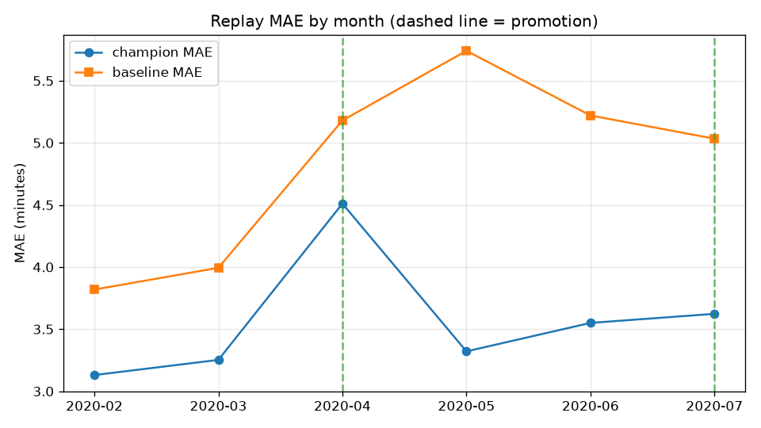
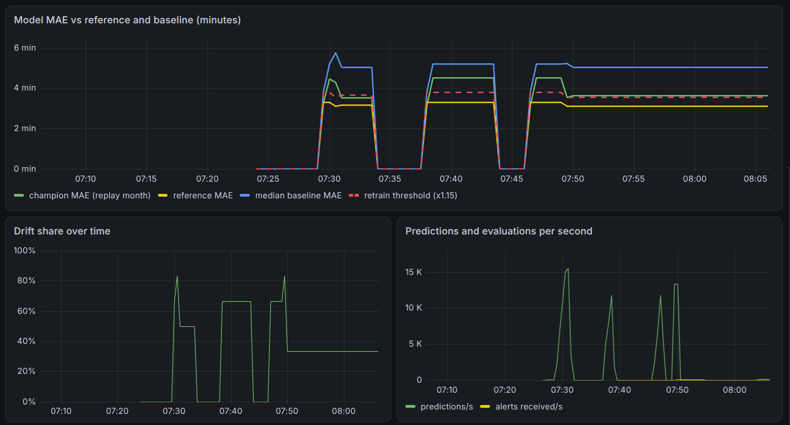
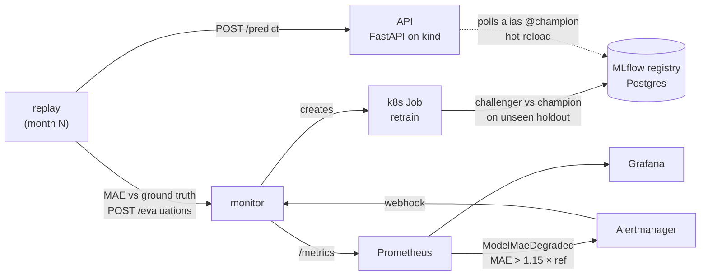

# nyc-taxi-mlops

[](https://github.com/Lamine2004Sow/nyc-taxi-mlops/actions/workflows/ci.yml)

**Predicts a NYC yellow-taxi trip duration at pickup time to within ~3.3 minutes (MAE), 17% better than a
per-route median baseline. The model then runs in a self-healing loop: when COVID hit in April 2020, the
platform detected the degradation, retrained a challenger in Kubernetes and promoted it on its own.**

Everything runs locally at zero cost (kind + Docker Compose). GitHub Actions does the CI.



## What happened during the replay

The champion is trained on January 2020. February to July 2020 are replayed as "production" through
the API deployed on kind. The real durations from the TLC data are joined afterwards (ground truth),
the same way delayed labels arrive in production.

| month | served model | MAE (min) | baseline MAE | drift share | what the platform did |
|---|---|---|---|---|---|
| 2020-02 | v1 | 3.13 | 3.82 | 0.00 | nothing, healthy |
| 2020-03 | v1 | 3.25 | 3.99 | 0.00 | nothing, healthy |
| **2020-04** | v1 | **4.51** | 5.18 | 0.67 | **alert, retrain Job, v2 promoted** (holdout MAE 4.49 → 3.09) |
| 2020-05 | v2 | 3.32 | 5.74 | 0.83 | recovered |
| 2020-06 | v2 | 3.55 | 5.22 | 0.83 | nothing (still below the 15% threshold) |
| **2020-07** | v2 | **3.62** | 5.03 | 0.33 | **alert, retrain Job, v3 promoted** (holdout MAE 3.63 → 3.04) |

Drift was high from April onwards even when the error was fine (May, June). That is why retraining
is triggered on **MAE degradation**, and drift is kept as a diagnostic
([ADR 0002](docs/adr/0002-retrain-trigger-on-mae-not-drift.md)). Full report: [reports/replay.md](reports/replay.md),
with one Evidently HTML report per month in [reports/drift/](reports/drift/). Promotion decisions:
[reports/promotions.jsonl](reports/promotions.jsonl).

### Grafana during the replays



Each block is one replay run. When the green line (champion MAE) crosses the dashed line
(1.15 × reference MAE), `ModelMaeDegraded` fires. After the promotion, the reference (yellow) moves to
the new champion's own MAE.

## How the loop works



1. **Serve**: the API serves the model behind the MLflow alias `champion` and polls it every 30 s,
   so a promotion goes live without a redeploy.
2. **Observe**: the replay sends the month's trips to the API, joins the true durations by `request_id`
   and pushes MAE, baseline MAE and Evidently drift to the monitor.
3. **Alert**: a PrometheusRule fires `ModelMaeDegraded` once per degraded month.
4. **Retrain**: Alertmanager calls the monitor's webhook. The monitor creates a Kubernetes Job, with RBAC,
   a cooldown and dedupe so the same alert does not start two Jobs.
5. **Gate**: the challenger trains on January plus the first 75% of the degraded month. Champion and
   challenger are then compared on the last 25%, which neither of them has seen. The challenger is promoted
   only if it is at least 2% better.

## Engineering choices

- **No data leakage**: `trip_distance` is measured by the taximeter *after* the ride, so it cannot be a
  feature. The model uses the distance between zone centroids (from the TLC shapefile), the
  pickup/dropoff zones, the hour and the weekday. A test fails if a forbidden column becomes a feature
  ([ADR 0005](docs/adr/0005-leak-free-features.md)).
- **The baseline is a contract**: CI trains on a frozen fixture and fails if the model does not beat the
  median-per-route baseline.
- **Reproducible data**: [data/manifest.json](data/manifest.json) records the URL, size and SHA-256 of
  each TLC file. Dependencies are locked in `uv.lock`.
- **Deliberately left out**: a GitOps controller ([ADR 0003](docs/adr/0003-no-gitops-controller.md)),
  ONNX ([ADR 0004](docs/adr/0004-no-onnx.md)) and a cloud deployment
  ([ADR 0001](docs/adr/0001-local-first-platform.md)).

## Run it

Requirements: Docker, kind, kubectl, helm, [uv](https://docs.astral.sh/uv/) and about 8 GB of free RAM.
`make tools` installs kind, kubectl and helm.

```bash
make install      # Python deps
make up           # kind + local registry, MLflow + Postgres, kube-prometheus-stack, image, deploy
make train        # champion v1 on 2020-01, registered in MLflow
make replay-live  # replays 2020-02..07 through the cluster; alerts trigger retrain Jobs
```

| UI | URL |
|---|---|
| API docs | http://127.0.0.1:30080/docs |
| Grafana (admin/admin), dashboard "NYC Taxi MLOps" | http://127.0.0.1:30300 |
| Prometheus | http://127.0.0.1:30090 |
| MLflow | http://127.0.0.1:5000 |

No cluster? `make data train replay` runs the same loop offline, with retraining done in-process.

```bash
curl -s -X POST http://127.0.0.1:30080/predict -H 'content-type: application/json' \
  -d '{"trips":[{"pickup_datetime":"2020-03-02T08:30:00","PULocationID":161,"DOLocationID":138}]}'
# {"model_version":"1","predictions":[{"request_id":"...","duration_min":30.9}]}
```

## CI (GitHub Actions)

`lint` (ruff) → `test` (pytest, coverage report) → `model-gate` (must beat the baseline) → `docker`
(build, push to `ghcr.io/lamine2004sow/nyc-taxi-mlops` on `main`) → `kind-smoke` (deploys the image on
a throwaway kind cluster and calls `/health`, `/predict` and `/metrics`).

## Repository layout

```
src/nyc_taxi/          data, features, baseline, model, registry, drift, pipeline (replay/retrain), CLI
src/nyc_taxi/api/      FastAPI serving + Prometheus metrics + alias hot-reload
src/nyc_taxi/monitor/  evaluation metrics + Alertmanager webhook → retrain Job
infra/                 kind, Kustomize (base, overlays local/ci), Helm values, Grafana dashboard, MLflow image
docs/                  architecture, runbook, SLOs, ADRs
reports/               replay results committed from the last run
```

Ops docs: [architecture](docs/architecture.md) · [runbook](docs/runbook.md) · [SLOs](docs/slo.md) ·
[ADRs](docs/adr/).

Data: [NYC TLC Trip Record Data](https://www.nyc.gov/site/tlc/about/tlc-trip-record-data.page).
