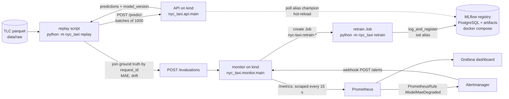

# Architecture

The project is a closed loop: serve a duration model, replay production months against it, measure the
error with ground truth, retrain when the error degrades, and promote the winner through an MLflow alias
that the API polls.

## Loop

Reading the loop:

1. The replay sends one month of trips to the API, which returns predictions tagged with the served
   `model_version`.
2. The replay joins the true durations by `request_id`, computes MAE for the champion and for the
   median baseline, and computes the drift report.
3. It posts the result to the monitor, which exports it as gauges (`model_mae_latest`, `model_ref_mae`).
4. Prometheus evaluates `ModelMaeDegraded` (`model_mae_latest > model_ref_mae * 1.15`). Alertmanager
   sends the firing alert to the monitor webhook.
5. The monitor creates a retrain Job (with cooldown and active-Job dedupe). The Job trains a challenger,
   gates it on a time holdout against the champion, and moves the `champion` alias if it wins by 2%.
6. The API polls the alias every `MODEL_POLL_SECONDS` and swaps the model in memory.

The replay also waits for the Job (`wait_for_retrain`) in cluster mode, so the replay report records
the promotion in the same run.

## Components

| Component | Runs on | Role | Source |
|---|---|---|---|
| Replay / training CLI | Host (`uv run`) | Downloads TLC months, trains the champion, replays, retrains | `src/nyc_taxi/pipeline.py`, `__main__.py` |
| Features and baseline | Shared library | One feature function for training, replay and API; median baseline | `features.py`, `baseline.py` |
| Model store | Shared library | LightGBM booster + `meta.json`, MLflow log/register/alias | `model.py`, `registry.py` |
| API | kind (`nyc-taxi` namespace, 2 replicas) | `/predict`, `/health`, `/metrics`; alias polling and hot-reload | `src/nyc_taxi/api/`, `infra/k8s/base/api.yaml` |
| Monitor | kind (1 replica) | Receives evaluations, exports gauges, launches retrain Jobs | `src/nyc_taxi/monitor/`, `infra/k8s/base/monitor.yaml` |
| Retrain Job | kind, on demand | `python -m nyc_taxi retrain --month <month>` | `monitor/jobs.py` |
| Prometheus, Alertmanager, Grafana | kind `monitoring` namespace (Helm) | Scrape, alert rules, routing to the webhook, dashboard | `infra/helm/kube-prometheus-stack-values.yaml`, `infra/k8s/components/monitoring/`, `infra/grafana/` |
| MLflow + PostgreSQL | docker compose | Experiment tracking, model registry, aliases, artifacts | `docker-compose.yml`, `infra/mlflow/Dockerfile` |
| Image registry | `localhost:5001` (registry container) | Holds the single image used by the API, monitor and retrain Job | `scripts/kind-with-registry.sh` |
| CI | GitHub Actions | Lint, tests, model gate, image to GHCR, kind smoke test | `.github/workflows/ci.yml` |

Access from the host: API `127.0.0.1:30080`, monitor `127.0.0.1:30081`, Prometheus `127.0.0.1:30090`,
Grafana `127.0.0.1:30300`, MLflow `127.0.0.1:5000`. Operational details are in [runbook.md](runbook.md),
and objectives are in [slo.md](slo.md).
